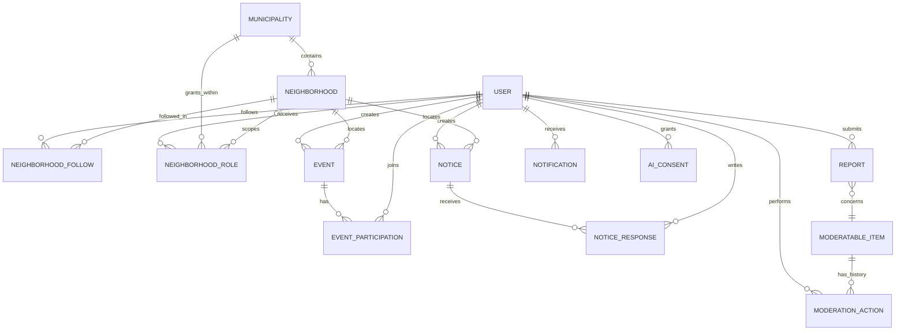

# Modelo de dados

O modelo conceitual abaixo preserva a proposta do produto. A implementação PostgreSQL atual usa as tabelas descritas na seção de correspondência; as migrações SQL são a fonte dos tipos, chaves e restrições físicas. AIConsent continua conceitual, sem integração externa ativa.

## Relações

MODERATABLE_ITEM é uma referência conceitual a um evento, aviso ou resposta; na implementação deve ser modelada de forma que a chave estrangeira e o tipo de conteúdo sejam verificáveis. Não usar uma relação polimórfica sem definir como garantir integridade.

## Entidades e limites

| Entidade | Papel no produto | Campos/regras que precisam ser definidos |
| --- | --- | --- |
| User | Conta e preferências. | Nome de exibição, e-mail, credencial protegida, estado da conta e preferências. Não guardar localização residencial sem necessidade. |
| Municipality | Município e fronteira administrativa. | Nome, identificador oficial se necessário, estado e administradores autorizados. |
| Neighborhood | Unidade de feed e escopo de moderação. | Nome, município, estado ativo/inativo e nomes alternativos de busca. |
| NeighborhoodFollow | Bairros principal e acompanhados pela conta. | Uma relação deve indicar bairro principal sem duplicar acompanhamento. |
| NeighborhoodRole | Designação municipal de moderador ou administrador. | Papel, escopo, concedente, início, revogação/validade e motivo. Verificar no servidor. |
| Event | Atividade comunitária. | Autor, bairro, local, início/fim, limite, custo e estado; política de edição/cancelamento. |
| EventParticipation | Confirmação ou cancelamento de presença. | Restrição única por evento/conta e regra para vagas concorridas. |
| Notice | Aviso ou pedido/oferta de ajuda. | Autor, categoria, bairro, local público, estado e histórico de atualização. |
| NoticeResponse | Resposta ou oferta de colaboração associada a um aviso. | Autor, conteúdo, estado de moderação e data. |
| Report | Denúncia enviada para análise. | Autor protegido, item, motivo, contexto, estado e datas. |
| ModerationAction | Histórico imutável de decisão. | Ator, item, escopo, ação, justificativa, data e pedido/revisão relacionada. |
| Notification | Registro de notificação dentro do produto. | Destinatário, evento que a originou, canal e estado de leitura/entrega. |
| AIConsent | Evidência mínima de consentimento para uma chamada opcional. | Conta, finalidade/versão do aviso de consentimento, data e retirada. Evitar persistir o rascunho enviado sem necessidade. |

## Regras de integridade

Uma publicação pertence a um município por meio de seu bairro. A troca de bairro deve verificar que o bairro está ativo e dentro do município selecionado. Guardar uma linha de designação por bairro autorizado; uma função administrativa municipal pode ter escopo de município, sem bairro específico. A auditoria deve permanecer consultável após desativação de conta ou bairro, de acordo com uma política de retenção ainda a definir.

O diagrama conceitual não define política legal de retenção. As migrações já implementam tipos, índices e chaves; a política de retenção continua pendente.

## Correspondência com PostgreSQL — 08/11/2026

| Conceito | Tabela implementada |
| --- | --- |
| Conta e sessão | accounts, sessions, account_tokens |
| Município, bairro e acompanhamento | municipalities, neighborhoods, follows |
| Permissão territorial | roles |
| Evento, aviso e comunicado | posts, diferenciados por kind |
| Inscrição | participations, chave única por publicação e conta |
| Resposta e denúncia | replies, reports |
| Decisão e recurso | audit, appeals |
| Notificação e envio de e-mail | notifications, mail_outbox |
| Imagem | media, conteúdo binário validado |
| Controle local de exemplos | demo_records |

Bairro principal fica em accounts; follows registra acompanhamentos. Papéis administrativos são municipais; moderadores recebem escopo de bairro. Remoção de publicação altera visibilidade, preservando rastreabilidade. Exclusão de conta tem anonimização técnica específica; não equivale a política de retenção aprovada nem apaga backups automaticamente.

~~~mermaid
erDiagram
  municipalities ||--o{ neighborhoods : contem
  neighborhoods ||--o{ accounts : bairro_principal
  neighborhoods ||--o{ posts : localiza
  accounts ||--o{ posts : publica
  accounts ||--o{ roles : recebe
  accounts ||--o{ sessions : inicia
  posts ||--o{ participations : recebe
  accounts ||--o{ participations : confirma
  posts ||--o{ replies : recebe
  posts ||--o{ reports : recebe
  audit ||--o{ appeals : permite_revisao
~~~

Este recorte físico mostra as relações centrais; consultar api/migrations/ para todas as chaves e tabelas auxiliares.
