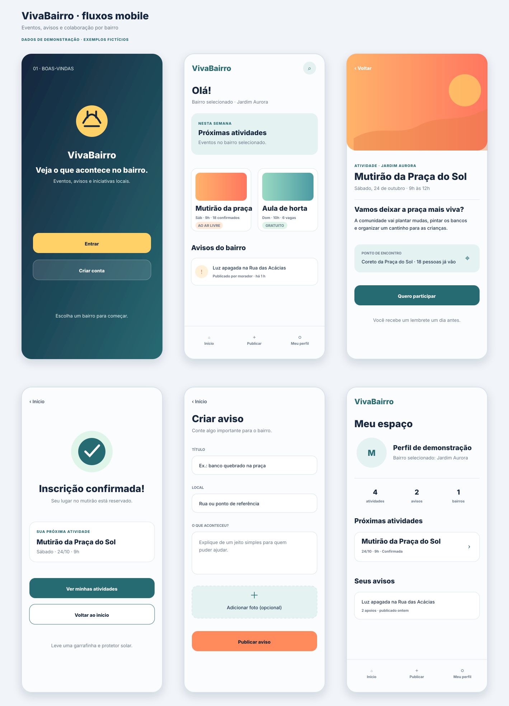
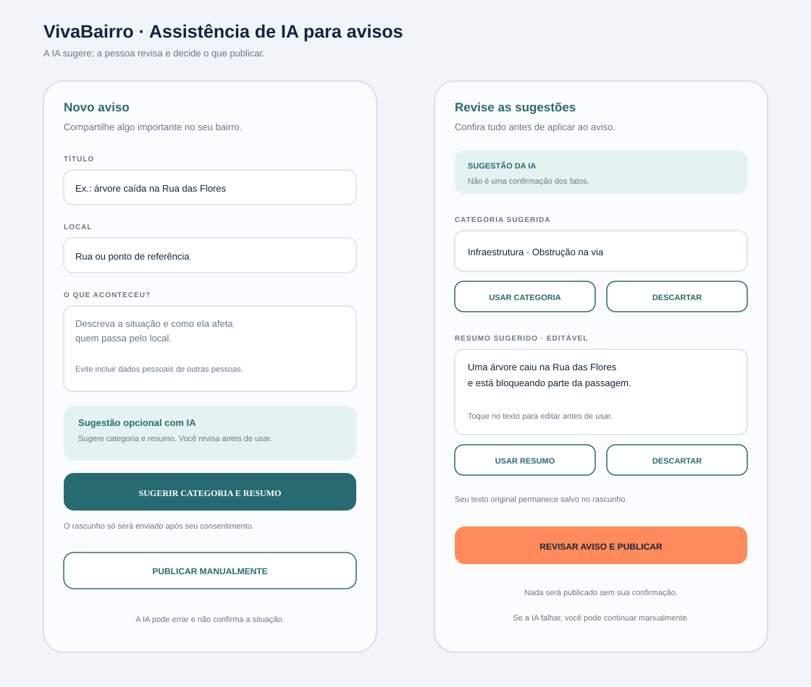
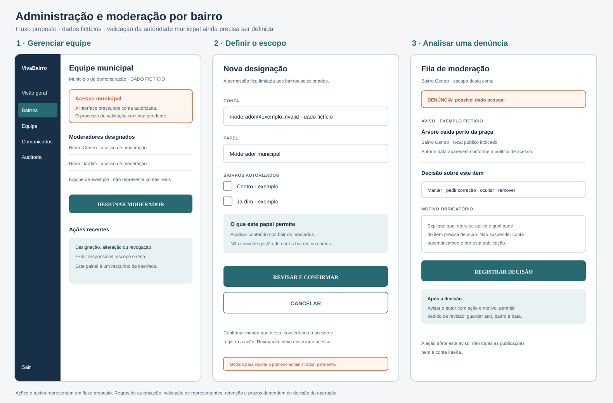
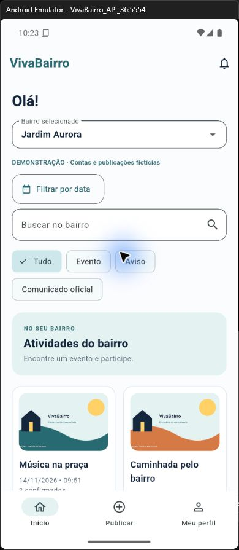
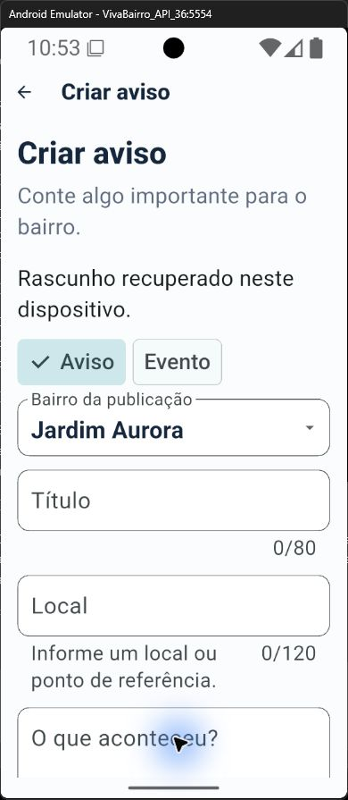

# Protótipo e fluxos de interface

## Protótipo mobile

O [arquivo SVG do protótipo mobile](../assets/prototipo-vivabairro.svg) está incluído nesta página para consulta no GitBook. Ele deriva do export vetorial que estava na pasta de usabilidade e recebeu alterações neste repositório, portanto não deve ser tratado como uma cópia intacta do arquivo original do Figma. O arquivo é um protótipo visual, não uma aplicação funcionando.

As telas mostram entrada, feed, detalhe e confirmação de evento, criação de aviso e perfil. Nomes, bairros, contagens e eventos são dados de demonstração. O SVG é a referência visual para implementar as telas; a captura JPG em `assets/` serve apenas como material de apoio. Preserve o arquivo-fonte do Figma separadamente quando ele estiver disponível; registre propostas de alteração sem apresentá-las como parte do original.

## Fluxo opcional de IA

O fluxo acrescenta uma decisão explícita antes de enviar título e descrição a um provedor externo. A caixa de autorização começa desmarcada; a tela informa os campos enviados, o uso e a alternativa sem IA. O resultado deixa categoria e resumo editáveis, mantém o original e exige uma confirmação de publicação separada.

Antes de usar serviço real, decidir provedor, política de retenção, texto final de consentimento e canal para explicar tratamento de dados. A tela atual é um fluxo proposto; a caixa está desenhada como estado ainda não autorizado.

## Fluxo de administração e moderação

O material mostra designação restrita a bairros, análise de um item, motivo obrigatório e histórico. A validação de quem pode ser o primeiro administrador municipal está marcada como pendente porque o processo ainda não foi decidido. Dados são fictícios.

## Telas que completam o produto

A próxima revisão do arquivo de design deve contemplar:

- cadastro, recuperação de acesso e escolha de município/bairro;
- busca e filtros, lista vazia e erro de conexão;
- formulário e edição de evento, lotação, mudança de horário e cancelamento;
- criar/editar aviso, atualizar estado e oferecer ajuda;
- central de notificações e preferências;
- denúncia, fila de moderação, pedido de ajuste, ocultação, remoção, restauração e recurso;
- designação/revogação de moderador e criação/correção de comunicado municipal;
- estados de carregamento, falha e recuperação de rascunho.

## Revisão de conteúdo visual

Usar rótulos que correspondam aos documentos: “evento” para atividade, “aviso” para ocorrência comunitária, “comunicado municipal” para publicação oficial. Distinguir esses tipos pela palavra e contexto, não só por cor. Marcar qualquer dado de demonstração como fictício; não usar nomes, estatísticas ou recomendações sem regra. Em formulários sensíveis, apresentar privacidade, confirmação e recuperação junto à ação correspondente.

As telas propostas ainda precisam ser percorridas com participantes. Registrar versão, tarefa, dúvida observada e alteração escolhida; não afirmar que a interface foi validada antes de realizar essas sessões.

## Aplicação nas telas Android

O SVG de alta fidelidade confirmado permanece a referência, com cópia em [docs/design](../docs/design/vivabairro_a3_prototipo-mobile.svg). O app Flutter também possui telas de segurança da conta, filtros, moderação, revisão e administração. Isso não altera a autoria nem substitui o protótipo original. A prévia web serve de apoio; a verificação nativa está registrada em [implementação](../docs/IMPLEMENTACAO.md).

