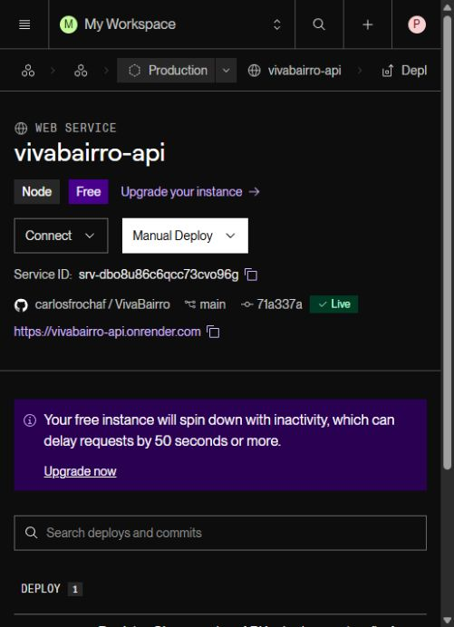
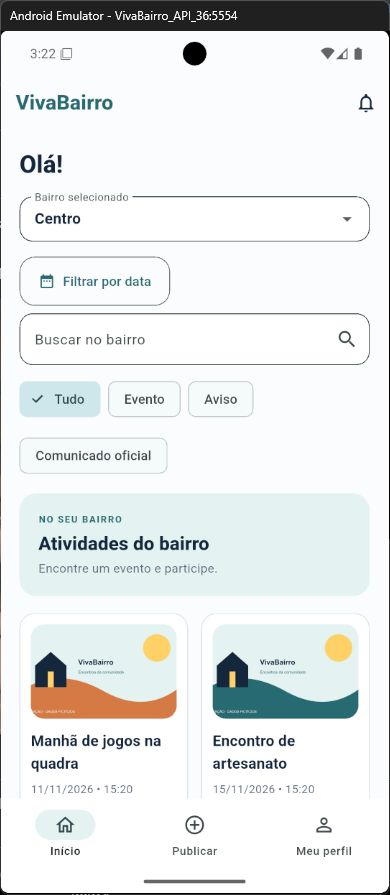
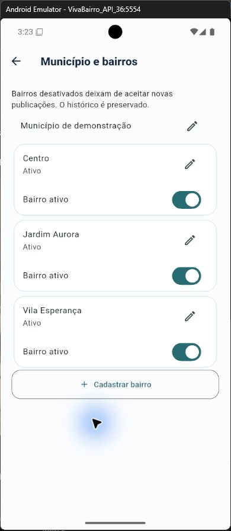
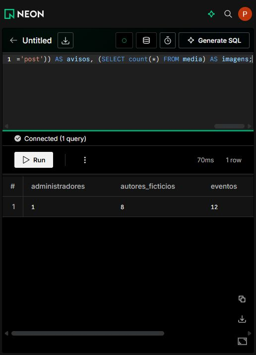

# Hospedagem no Render e Neon

## Estado atual — 16/11/2026

A demonstração está publicada no Render Free com PostgreSQL no Neon. A versão da API é b7c29d2, verificada online em 15/11; a administração pelo aplicativo foi conferida em 16/11. APKs debug atualizados e seus hashes estão em “APK atualizado e ambiente Android”, nesta página. Teste físico e preparação operacional para uso público continuam pendentes. Os registros abaixo preservam as datas das implantações e revisões.

## Implantação inicial — 08/11/2026

Render Free para a API e Neon Free para PostgreSQL foram aprovados. O projeto Neon VivaBairro foi criado com PostgreSQL 18 na região São Paulo. A API foi publicada em https://vivabairro-api.onrender.com, no Render Free em Virginia. Primeiro deploy do commit 71a337a concluído em 08/11/2026, com migrações aplicadas no Neon. /health retornou HTTP 200 e confirmou a conexão com o banco. /api/config confirmou modo de caixa fictícia desabilitado, e-mail indisponível e push não configurado.

## Serviço da API

O serviço existente usa este repositório, diretório raiz api, runtime Node e plano Free. Para reproduzir a configuração em outro ambiente, usar:

~~~text
Build: npm ci --include=dev && npm run build && npm prune --omit=dev
Start: node dist/migrate.js && node dist/main.js
Health check: /health
~~~

As migrações usam transação e bloqueio. A API escuta em 0.0.0.0 e usa a porta fornecida pelo Render. Publicações são manuais para permitir verificar cada versão antes da apresentação.

DATABASE_URL recebe a conexão do Neon, preservando seus parâmetros de TLS. Guardar a credencial apenas nas variáveis privadas do Render. Nunca colocar senha no Git, APK, chat ou capturas de tela. O aplicativo recebe somente a URL pública HTTPS da API.

Manter NODE_ENV=production, DEMO_MODE=false e JOBS_ENABLED=true. A caixa fictícia de e-mail é exclusiva do ambiente local. Não ativar Neon Auth/Better Auth: a API atual cuida das contas e permissões.

## Administrador inicial

Após as migrações, o operador executa em ambiente confiável conectado ao banco correto:

~~~text
node dist/bootstrap-admin.js --municipality identificador --name "Município de demonstração" --neighborhood "Bairro inicial" --email email-do-responsavel
~~~

A senha vem de BOOTSTRAP_PASSWORD, com pelo menos 12 caracteres, e deve ser removida do ambiente após o uso. O comando recusa sobrescrever um município com administrador ativo. Não comprova vínculo institucional. Não publicar credenciais administrativas. Seed e caixa fictícia destinam-se ao ambiente local; não habilitá-los automaticamente na internet.

## Conferência e APK

Validar /health, cadastro, login, publicação, participação, permissões, reinício com dados preservados e conexão HTTPS pelo app. Registrar URL, commit e resultado antes de considerar a implantação concluída.

Gerar APK com scripts/android-demo.ps1 -ApiUrl "https://URL-DA-API". O script gera APKs debug por arquitetura para demonstração; não são artefatos de loja ou assinados com chave própria de distribuição. O teste físico está pendente por falta de aparelho.

## Limites do plano gratuito

O Render suspende o serviço após inatividade e a primeira abertura pode demorar. Antes da apresentação, abrir /health e aguardar a resposta; não usar tráfego artificial para contornar limites. Lembretes são processados enquanto a API está acordada, sem garantia de horário. Banco e imagens ficam no Neon, fora do disco temporário do Render.

E-mail externo depende de provedor e rede compatíveis com o plano. Sem essa configuração, recuperação por e-mail na internet não está validada. Push não está conectado. Antes de usar dados reais, definir retenção, backup, restauração e operação.

Fontes consultadas em 08/11/2026: [Render Free](https://render.com/docs/free), [Blueprint](https://render.com/docs/blueprint-spec) e [conexão Neon](https://neon.com/docs/connect/connect-from-any-app). Conferir condições no painel antes de mudar plano.

## Artefato Android online

APKs debug ARM64, ARM32 e x86_64 compilados com API_URL=https://vivabairro-api.onrender.com. Cópias locais em .local/artifacts/VivaBairro-online-arm64-debug.apk e VivaBairro-online-arm32-debug.apk. Não precisam da API no computador; precisam de internet e disponibilidade do serviço gratuito. Compilação não equivale a teste físico.

## Validação remota realizada

Em 08/11/2026, foram inicializados Município de demonstração e os bairros Jardim Aurora, Centro e Vila Esperança. Com uma conta temporária, foram aprovados cadastro, consulta de conta, saída, novo login, gravação/leitura de aviso no Neon e recusa de comunicado oficial sem permissão. A conta foi encerrada e seu conteúdo público removido ao final. Esses testes foram feitos por HTTPS na API hospedada; não equivalem a teste físico do aplicativo.

O banco remoto é separado do banco local. O responsável criou sua conta e definiu a senha diretamente no aplicativo. Depois da confirmação, recebeu o papel admin somente no Município de demonstração, com registro de auditoria. O painel Município e bairros foi aberto e verificado no emulador conectado à API online. O endereço pessoal não é publicado nesta documentação. Não existem credenciais administrativas públicas.

## Dados de demonstração online

Em 08/11/2026, foram carregados oito autores fictícios, 12 eventos, dez avisos, 12 imagens e exemplos de participações e respostas. Há atividades em três bairros, um evento lotado, um cancelado, um já realizado e avisos em estados diferentes. As contagens vêm do banco; dados e ilustrações são fictícios. O feed online com imagens foi conferido no emulador.

Os exemplos foram gerados a partir de api/src/demo-data.ts. A carga online não cria moradores com a senha pública do seed local nem contas de moderador/administrador de demonstração. Os autores fictícios recebem hash de senha aleatória descartada, sem credencial de acesso divulgada. A única administração ativa é a conta designada pelo responsável. Não foi criado comunicado oficial em nome dessa pessoa.

Para preparar novamente a carga, executar npm --prefix api run build e node scripts/prepare-online-demo.mjs. O script apenas gera .local/online-demo.sql, sem se conectar ao banco. O operador confere o projeto e executa esse arquivo no editor SQL do Neon. O bloco exige o município fictício e os três bairros esperados, usa transação atômica e não substitui registros existentes. Não inserir essa carga na inicialização do servidor. O arquivo gerado permanece fora do Git.

A importação foi executada duas vezes em um schema PostgreSQL local isolado para verificar integridade e ausência de duplicação: oito contas, 22 publicações, 12 imagens e nenhum papel privilegiado criado pela carga. No Neon foram conferidos os mesmos totais de demonstração e um administrador. Novas execuções preservam datas e alterações de registros já existentes; reagendar uma apresentação futura exige revisão explícita dos exemplos.

## Revisão online de moderação — 15/11/2026

API b7c29d2 publicada manualmente e confirmada como Live no Render. O [registro de implementação](IMPLEMENTACAO.md) descreve testes HTTPS de denúncias, decisões, recursos, respostas e revogação. A preparação e revogação dos papéis temporários são operações controladas no Neon; não substituem teste da interface administrativa.

O roteiro scripts/check-online-moderation.mjs exige um arquivo privado .local/moderation-online-private.json com a URL autorizada, identificador da rodada, contas descartáveis (owner, reporter, moderator e reviewer), tokens, senhas e listas posts/checks. Esse arquivo não é versionado. As contas precisam ser preparadas explicitamente; o script não concede permissões. --run testa os fluxos, --revoked confere recusa após revogação e --cleanup encerra as contas e remove suas credenciais do arquivo local. Não usar contas de moradores ou o administrador real. Se houver falha, inspecionar o estado e concluir a limpeza antes de repetir; denúncias descartáveis abertas exigem fechamento restrito aos IDs dessa rodada.

## APK atualizado e ambiente Android

O SDK Android está restaurado e o APK atualizado está instalado no emulador Android 16/API 36. A compilação usa `scripts/android-demo.ps1 -ApiUrl "https://vivabairro-api.onrender.com"` e gera versões debug para ARM64, ARM32 e x86_64. Os arquivos de entrega ficam em `.local/artifacts/`, fora do Git. Não são uma versão de loja nem uma medição de tamanho de release.

O APK ARM64 `VivaBairro-online-arm64-debug.apk` tem 116.473.225 bytes e SHA-256 `1521de1eff2734029826e6efe88b99b7d1e73155efdd06e8fb12bb584472fda6`. O APK ARM32 `VivaBairro-online-arm32-debug.apk` tem 95.500.223 bytes e SHA-256 `8cffc946a8b98294c96444ec7297ed0b3ec11bcbdd834dfbba18d1e3f8745852`. Esses identificadores permitem conferir os artefatos desta entrega; uma nova compilação pode produzir hashes diferentes.

A API continua na versão b7c29d2; as correções desta entrega estão no aplicativo Flutter. Publicar documentação ou compilar o APK não atualiza automaticamente os aplicativos já instalados.

Em 16/11/2026, designação e revogação são verificadas pela interface Android conectada ao Render/Neon, com confirmação manual do responsável. A conferência HTTPS usa a mesma sessão antes e depois da retirada da permissão: papel limitado ao Centro, recusa de administração de designações e recusa de moderação após revogação. A conta temporária é encerrada, a sessão é invalidada e suas credenciais locais são descartadas. A revisão não exige alteração da API nem nova compilação do APK já identificado acima.

## Distribuição do APK — 24/11/2026

Os APKs ARM64 e ARM32 estão publicados na [release de demonstração](https://github.com/carlosfrochaf/VivaBairro/releases/tag/demo-2026-11-24), junto com SHA256SUMS.txt. Os hashes conferem com os artefatos identificados nesta página. A inspeção dos dois pacotes confirma a URL https://vivabairro-api.onrender.com e os textos atuais da administração de moderadores. Não houve recompilação nem alteração do aplicativo nesta publicação; o código mobile permanece igual ao da revisão.

A página [Demonstração e APK](APRESENTACAO.md) oferece os links diretos. Publicar o arquivo não comprova disponibilidade contínua da API: em 24/11, a consulta automatizada ao health recebeu uma página de verificação HTTP 403. Isso não permite concluir que o app esteja fora do ar nem confirmar um acesso completo nesta data. Esse é o resultado da primeira consulta automatizada, anterior à continuação do ensaio. O registro de 24/11 em implementação documenta a recuperação no APK e a validação do fluxo principal; o registro de 16/11 é preservado como histórico.

## APK corrigido — 24/11/2026, revisão 2

A [release demo-2026-11-24-r2](https://github.com/carlosfrochaf/VivaBairro/releases/tag/demo-2026-11-24-r2) contém as correções de horário digitado em 24 horas, mensagens de conexão e remoção e contagens no singular. A API continua em b7c29d2, sem alteração de banco ou de proteção do Render. Os pacotes são compilados com API_URL=https://vivabairro-api.onrender.com. A revisão mantém a release anterior disponível para rastreabilidade.

| Artefato | SHA-256 |
| --- | --- |
| [VivaBairro-online-arm32-debug.apk](https://github.com/carlosfrochaf/VivaBairro/releases/download/demo-2026-11-24-r2/VivaBairro-online-arm32-debug.apk) | `27130300d84350c8878dcf020e537f396c200555ffdafddf69904e17c76ed1ca` |
| [VivaBairro-online-arm64-debug.apk](https://github.com/carlosfrochaf/VivaBairro/releases/download/demo-2026-11-24-r2/VivaBairro-online-arm64-debug.apk) | `0335f461ac964eccebb19118031bc8ce8ebe8f749205cfafe5a627e95bac9d9e` |

[Arquivo de verificação SHA256SUMS.txt](https://github.com/carlosfrochaf/VivaBairro/releases/download/demo-2026-11-24-r2/SHA256SUMS.txt). Cópias locais em `.local/artifacts/demo-2026-11-24-r2/`.

O APK ARM64 corrigido é instalado no emulador preservando a sessão. O feed e o evento fictício continuam disponíveis; o seletor aceita 18:00 digitado e a edição é salva online. A bateria Flutter contém 25 testes aprovados e a análise estática não aponta problemas. ARM32 e x86_64 também compilam, mas não têm nova execução nesta rodada. Não há teste físico nem publicação em loja.
