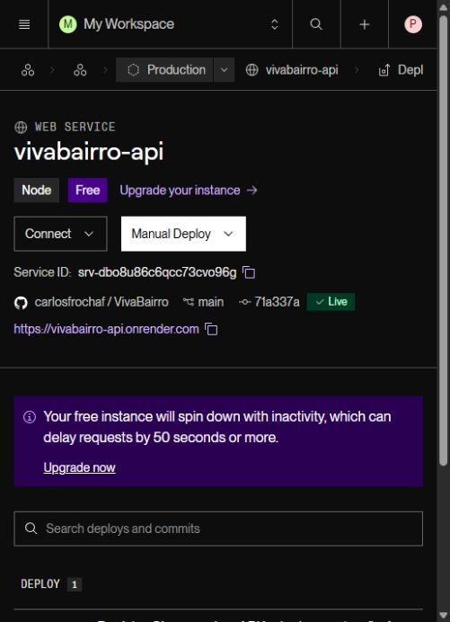

# Hospedagem no Render e Neon

## Estado em 08/11/2026

Render Free para a API e Neon Free para PostgreSQL foram aprovados. O projeto Neon VivaBairro foi criado com PostgreSQL 18 na região São Paulo. A API foi publicada em https://vivabairro-api.onrender.com, no Render Free em Virginia. Primeiro deploy do commit 71a337a concluído em 08/11/2026, com migrações aplicadas no Neon. /health retornou HTTP 200 e confirmou a conexão com o banco. /api/config confirmou modo de caixa fictícia desabilitado, e-mail indisponível e push não configurado. A Alfa anterior permanece separada.

## Serviço da API

Criar um novo Web Service a partir deste repositório, diretório raiz api, runtime Node e plano Free. Usar:

~~~text
Build: npm ci --include=dev && npm run build && npm prune --omit=dev
Start: node dist/migrate.js && node dist/main.js
Health check: /health
~~~

As migrações usam transação e bloqueio. A API escuta em 0.0.0.0 e usa a porta fornecida pelo Render. Publicações são manuais para permitir verificar cada versão antes da apresentação.

DATABASE_URL recebe a conexão do Neon, preservando seus parâmetros de TLS. Guardar a credencial apenas nas variáveis privadas do Render. Nunca colocar senha no Git, APK, chat ou capturas de tela. O aplicativo recebe somente a URL pública HTTPS da API.

Manter NODE_ENV=production, DEMO_MODE=false e JOBS_ENABLED=true. A caixa fictícia de e-mail é exclusiva do ambiente local. Não ativar Neon Auth/Better Auth: a API atual cuida das contas e permissões.

## Administrador inicial

Após as migrações, o operador executa em ambiente confiável conectado ao banco correto:

~~~text
node dist/bootstrap-admin.js --municipality identificador --name "Município de demonstração" --neighborhood "Bairro inicial" --email email-do-responsavel
~~~

A senha vem de BOOTSTRAP_PASSWORD, com pelo menos 12 caracteres, e deve ser removida do ambiente após o uso. O comando recusa sobrescrever um município com administrador ativo. Não comprova vínculo institucional. Não publicar credenciais administrativas. Seed e caixa fictícia destinam-se ao ambiente local; não habilitá-los automaticamente na internet.

## Conferência e APK

Validar /health, cadastro, login, publicação, participação, permissões, reinício com dados preservados e conexão HTTPS pelo app. Registrar URL, commit e resultado antes de considerar a implantação concluída.

Gerar APK com scripts/android-demo.ps1 -ApiUrl "https://URL-DA-API". O script gera APKs debug por arquitetura para demonstração; não são artefatos de loja ou assinados com chave própria de distribuição. O teste físico está pendente por falta de aparelho.

## Limites do plano gratuito

O Render suspende o serviço após inatividade e a primeira abertura pode demorar. Antes da apresentação, abrir /health e aguardar a resposta; não usar tráfego artificial para contornar limites. Lembretes são processados enquanto a API está acordada, sem garantia de horário. Banco e imagens ficam no Neon, fora do disco temporário do Render.

E-mail externo depende de provedor e rede compatíveis com o plano. Sem essa configuração, recuperação por e-mail na internet não está validada. Push não está conectado. Antes de usar dados reais, definir retenção, backup, restauração e operação.

Fontes consultadas em 08/11/2026: [Render Free](https://render.com/docs/free), [Blueprint](https://render.com/docs/blueprint-spec) e [conexão Neon](https://neon.com/docs/connect/connect-from-any-app). Conferir condições no painel antes de mudar plano.

## Artefato Android online

APKs debug ARM64, ARM32 e x86_64 compilados com API_URL=https://vivabairro-api.onrender.com. Cópias locais em .local/artifacts/VivaBairro-online-arm64-debug.apk e VivaBairro-online-arm32-debug.apk. Não precisam da API no computador; precisam de internet e disponibilidade do serviço gratuito. Compilação não equivale a teste físico.

## Validação remota realizada

Em 08/11/2026, foram inicializados Município de demonstração e os bairros Jardim Aurora, Centro e Vila Esperança. Com uma conta temporária, foram aprovados cadastro, consulta de conta, saída, novo login, gravação/leitura de aviso no Neon e recusa de comunicado oficial sem permissão. A conta foi encerrada e seu conteúdo público removido ao final. Esses testes foram feitos por HTTPS na API hospedada; não equivalem a teste físico do aplicativo.

O banco remoto é separado do banco local: os eventos e avisos do seed local ainda não foram transferidos. A primeira conta administradora está pendente da definição do e-mail e de senha fora do chat. Não existem credenciais administrativas públicas.

