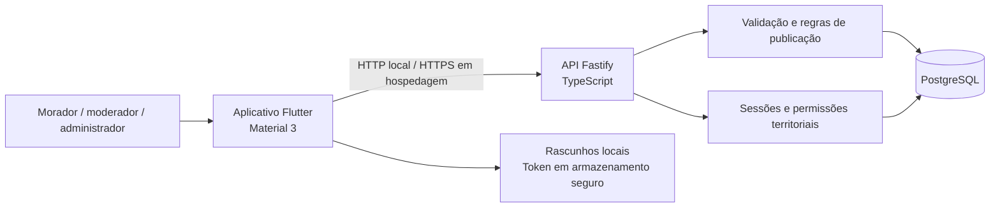

# Implementação do VivaBairro

## Referências e direção

### Correção visual de 08/11/2026

O responsável confirmou os arquivos `vivabairro_a3_prototipo-mobile.svg` e `vivabairro_a3_publicos-e-tarefas.svg`, enviados da pasta `Usabilidade - A3 - 1`. Cópias intactas estão em `docs/design/`. Os SVGs do aplicativo “filter” foram enviados por engano e não são referência do VivaBairro.

A primeira implementação não reproduzia a composição do protótipo. A revisão recupera o degradê e símbolo de entrada, cards ilustrados de eventos em duas colunas com adaptação para fonte ampliada, avisos separados, capa de evento, ponto de encontro, tela dedicada de inscrição confirmada e resumo “Meu espaço”. A prévia em computador limita a largura ao formato mobile. As contagens do perfil vêm do banco. Material 3 serve de base técnica, preservando a direção visual do produto.

Fotos, lembretes agendados e outras funções ainda indisponíveis não são simulados para imitar a imagem do protótipo. A localização opcional foi discutida como proposta, mas não foi implementada nem tornou o GPS obrigatório.

A revisão foi conferida na prévia local: entrada, feed, detalhe, inscrição confirmada após gravação no banco, formulário e perfil. Capturas estão em `docs/screenshots/`. O teste visual também identificou e corrigiu a configuração CORS de desenvolvimento para PUT/PATCH/DELETE; a saída da conta foi retestada com sucesso. A API possui testes para o resumo privado do perfil e para o preflight local, sem liberar origens externas. Android continua sem validação nativa.

Em 08/11/2026, a referência de produto foi consultada pelo [índice público do GitBook](https://vivabairro.gitbook.io/vivabairro/llms.txt), com 36 páginas, e pela [Alfa navegável](https://vivabairro-alfa.onrender.com). Os protótipos e SVGs originais continuam no repositório documental. Este repositório não os substitui.

A decisão atual é mobile em Flutter, API Node.js/TypeScript e PostgreSQL, sem Supabase. Trechos antigos do GitBook que ainda descrevem o produto final como site precisam ser conciliados com essa decisão em uma próxima atualização documental. Nenhuma alteração foi publicada no GitBook nesta etapa.

## O que foi implementado

| Área | Comportamento disponível |
| --- | --- |
| Conta | Cadastro, login, sessão persistida, logout com revogação no servidor, edição do nome e bairro |
| Comunidade | Seleção de bairro sem GPS, busca por título/descrição/local, filtros por tipo e categoria, paginação |
| Publicações | Avisos, eventos e comunicados oficiais; validação, edição do próprio conteúdo e remoção individual com histórico |
| Eventos | Início/término, intuito, local, capacidade opcional, confirmação e cancelamento de presença, cancelamento do evento, Meus eventos |
| Avisos | Categorias, respostas, estados aberto/em andamento/resolvido/encerrado e histórico |
| Rascunhos | Salvamento local por conta e publicação, restauração, manutenção em falhas, descarte explícito |
| Notificações | Caixa interna, marcação de leitura, avisos de respostas, mudanças em eventos e decisões de moderação |
| Moderação | Denúncias de publicação ou resposta, fila por território, motivo obrigatório, manutenção/ocultação/remoção/pedido de correção |
| Revisão | Solicitação pelo autor de publicação ou resposta em Revisões de moderação, análise por outra pessoa, histórico e notificação |
| Administração | Lista de moderadores, designação e revogação por bairro do próprio município, comunicados oficiais, cadastro/renomeação/ativação de bairros e renomeação do município |

Participações são únicas por conta/evento. A disputa por vagas usa bloqueio de linha em transação PostgreSQL, não apenas contagem na interface. Denúncias não escondem conteúdo automaticamente. Cadastro ignora atributos de privilégio enviados pelo cliente. Autorização territorial é refeita no servidor; esconder um botão não é uma medida de segurança suficiente.

Remoção é lógica. O autor vê a publicação removida na própria lista; outras pessoas deixam de acessá-la. Auditoria mantém decisão, motivo e ator. Alterações guardam a versão anterior para rastreabilidade, sem retornar esse conteúdo completo na consulta pública. Uma revisão não deve restaurar conteúdo que tenha recebido uma decisão posterior ou remoção do autor.

## Arquitetura

`mobile/lib/api.dart` centraliza transporte e sessão; `screens/` contém fluxos; `ui.dart`, componentes visuais compartilhados. A API mantém validação e autorização em `src/app.ts`, acesso transacional em `db.ts`, senha/token em `security.ts` e evolução do banco em migrações numeradas. Antes de ampliar os domínios, separar rotas e serviços de `app.ts` em módulos de conta, publicações e moderação para evitar crescimento de um único arquivo.

As senhas usam scrypt com salt. Sessões usam tokens aleatórios; o banco armazena apenas o hash do token e a validade. O aplicativo nativo usa `flutter_secure_storage`; a prévia web tem o armazenamento e as limitações do navegador. Rascunhos ficam nas preferências locais, não são criptografados como credenciais e não devem conter dados sensíveis. Não há leitura offline do feed nem envio automático de publicações pendentes.

## Usabilidade aplicada

Navegação principal com rótulos Início, Publicar e Meu perfil. Cores preservam a direção do protótipo: azul-marinho, verde-petróleo, verde-água, coral e amarelo. Material 3 fornece controles, foco, semântica e alvos de toque. Datas e diálogos usam português brasileiro. Estado não depende somente de cor: lotação, cancelamento e moderação têm mensagens textuais.

Formulários mantêm texto em erro, identificam campos obrigatórios e pedem confirmação antes de publicar ou remover. Botões mostram carregamento e evitam submissões repetidas durante operações. A interface tem estados vazios, tentativa novamente, rascunhos recuperáveis e rolagem com texto ampliado. O bairro é escolhido manualmente. Não pedimos GPS ou endereço residencial.

Isso não equivale a comprovação de acessibilidade completa. Falta testar TalkBack, navegação com teclado em todos os fluxos, foco após erros, contraste de todos os estados e testes de tarefa com moradores.

## Validação realizada

- API: compilação TypeScript, ESLint, testes com PostgreSQL real. Casos de cadastro sem autoatribuição, autenticação, edição por autor, disputa da última vaga, escopo municipal, denúncia sem remoção automática, revisão por outro responsável, revogação e persistência entre instâncias da API.
- Flutter: análise estática, testes de widgets e transporte HTTP. Formulário inválido não envia dados, boas-vindas suporta fonte ampliada, rascunho permanece após falha e ações sem corpo não enviam JSON vazio.
- Build da prévia web concluído. Verificação visual local de login, feed e fluxo de presença. APK Android debug x86_64 também compilado e instalado; login, feed com imagens e detalhe de evento conferidos no emulador Android 16/API 36. Não foi medido desempenho de release ou em aparelho real.
- Dependências: override de minimatch 11.0.5 na ferramenta de lint para corrigir o advisory GHSA-g3hv-75wg-m249; lint e build executados após a atualização. Manter o override apenas enquanto as dependências transitivas precisarem dele.

## O que falta antes de disponibilizar para uso real

Foram implementados recuperação e verificação de e-mail, alteração de senha, exclusão de conta, imagens, lembretes internos, filtros por período e feed dos bairros acompanhados. A seção de demonstração abaixo explica como verificar esses fluxos. Push externo, IA, validação da identidade institucional e política definitiva de retenção continuam pendentes.

Também faltam revisão dos requisitos com a equipe, automatização de deploy, configuração de HTTPS, backup/restauração, observabilidade, estratégia para retenção de sessões e teste de carga. A API usa um limitador local por processo; múltiplas instâncias precisam de armazenamento compartilhado. A ausência de um provedor de IA retorna indisponibilidade explícita, sem resultado fictício.

Android Studio, SDK API 36, NDK e o emulador VivaBairro_API_36 foram instalados. O emulador Android 16 iniciou com aceleração WHPX. O APK debug x86_64 foi compilado e instalado no emulador. Foi incluído um ícone vetorial com o símbolo e as cores do aplicativo. Assinatura de distribuição e teste em aparelho real seguem pendentes. Não há promessa de tamanho, consumo de memória ou taxa de quadros antes de medir em aparelhos reais.

## Decisões que precisam da equipe

Definir quem autoriza o primeiro administrador municipal; como verificar identidade institucional; quais municípios/bairros entram no piloto; política de retenção/exclusão; serviço de e-mail; hospedagem de API e PostgreSQL; armazenamento de fotos; se IA entra no primeiro lançamento. Enquanto isso, todas as contas privilegiadas e localidades do seed são explicitamente fictícias e locais.

## Referências técnicas

- [Flutter: instalação manual do SDK](https://docs.flutter.dev/install/manual) e [pubspec](https://docs.flutter.dev/tools/pubspec).
- [Flutter: configuração Android](https://docs.flutter.dev/platform-integration/android/setup).
- [Material Design 3](https://m3.material.io/) para componentes e padrões de interação.
- [Fastify](https://fastify.dev/docs/latest/) para API, hooks e testes por injeção HTTP.
- [PostgreSQL: bloqueios explícitos](https://www.postgresql.org/docs/current/explicit-locking.html) para concorrência nas inscrições.

Este documento registra implementação e limitações. O GitBook continua como referência funcional; mudanças de regra devem ser conciliadas nos dois lugares, sem duplicar toda a documentação aqui.

## Demonstração ampliada — 08/11/2026

O seed acrescenta oito moradores fictícios (ana, bruno, carla, diego, elisa, felipe, gabriela e hugo, todos @vivabairro.test), 12 eventos ilustrados, dez avisos e um comunicado municipal. Mantém as três contas e publicações iniciais. A senha inicial é a variável SEED_PASSWORD; o seed não altera senhas ou conteúdo já existente. Não usar essas credenciais em produção.

Há eventos lotado, cancelado, já realizado e nas próximas 24 horas, bairros distintos, respostas e avisos em diferentes estados. As ilustrações são geradas localmente e identificadas como fictícias. Os dados não representam pessoas, prefeituras ou ocorrências reais. Rode npm run demo:refresh na pasta api antes de uma apresentação futura para reagendar somente os eventos cadastrados pelo seed; esse comando não apaga publicações criadas pela interface.

### Conta, imagens e lembretes

Na entrada, Esqueci minha senha solicita um código. A caixa local fica na mesma tela e atende somente contas fictícias registradas pelo seed, com domínio @vivabairro.test, requisição loopback e DEMO_MODE=true fora de produção. Não é uma caixa pública de e-mail. Códigos duram 30 minutos, são de uso único e a recuperação revoga sessões. Nenhum e-mail é enviado pela internet sem configurar SMTP. Novos cadastros comuns não têm acesso à caixa fictícia; para testar entrega a endereços reais, configurar um provedor.

Meu espaço → Conta e segurança permite confirmar e-mail, trocar senha e excluir a conta mediante senha e confirmação. A exclusão remove sessões, preferências, imagens e conteúdo público; substitui identificação e textos pessoais, preservando referências técnicas mínimas. Isso não define uma política jurídica de retenção nem apaga automaticamente backups. A última conta administradora de um município não pode ser excluída sem sucessão. Ainda não há interface de transferência da administração: esse procedimento depende do operador e da validação institucional.

Uma foto por publicação, opcional: JPG, PNG ou WebP até 2 MB. O servidor valida o conteúdo, limita resolução, remove metadados e converte para JPEG. O acesso exige sessão e permissão. Nesta demonstração as imagens ficam no PostgreSQL; armazenamento de objetos e limites de volume por conta precisam ser definidos para escala. Imagens enviadas e não publicadas permanecem para permitir retomada de rascunhos; falta política de limpeza desses arquivos.

Em Editar perfil e preferências, Lembretes de eventos controla avisos internos até 24 horas antes. Com JOBS_ENABLED=true, a API processa a cada minuto; npm run jobs:run executa uma rodada manual. Não há notificação no sistema operacional com o aplicativo fechado. Os lembretes são deduplicados e respeitam presença ativa, preferência e cancelamento.

### Administração e serviços externos

Município e bairros permite cadastrar, renomear, desativar e reativar bairros do próprio município. Desativação bloqueia novas publicações e preserva histórico. O operador pode provisionar o primeiro administrador com npm run admin:bootstrap -- --municipality identificador --name "Nome do município" --neighborhood "Bairro inicial" --email email-institucional, definindo BOOTSTRAP_PASSWORD no ambiente. O comando recusa sobrescrever município com administrador ativo; não representa verificação automática da prefeitura.

Para e-mail real, a API tem fila SMTP com TLS, configurável em .env.example. Opções a avaliar: [Resend](https://resend.com/docs/send-with-smtp), que requer chave e domínio verificado, ou [Brevo](https://developers.brevo.com/docs/smtp-integration), com credenciais SMTP próprias. Nenhum serviço foi contratado ou conectado. Para push, a indicação técnica é [Firebase Cloud Messaging para Flutter](https://firebase.google.com/docs/cloud-messaging/flutter/get-started); a integração ainda exige criar o projeto, configurar o app Android, registrar tokens e tratar permissão/entrega. Isso não exige migrar nosso banco PostgreSQL para Firebase.

### Roteiro de apresentação e validação

Entrar como morador; conferir autores distintos no feed; filtrar um período; acompanhar outro bairro no perfil e selecionar Todos os meus bairros; abrir evento lotado e cancelado; confirmar presença num disponível; consultar Meus eventos e notificações. Criar um aviso com foto e conferir preservação do rascunho após erro de rede. Como moderador, analisar uma denúncia com motivo; voltar ao autor e pedir revisão; usar outro responsável para analisar o recurso. Como administrador, cadastrar um bairro de teste e alternar sua disponibilidade. Recuperação de senha pode ser apresentada com uma conta fictícia secundária, pois troca de senha invalida sessões anteriores.

Foram executados testes automatizados em PostgreSQL com schema isolado para autoria das imagens, visibilidade após remoção, formatos inválidos, escopo territorial, proteção do último administrador, códigos de recuperação e verificação, revogação de sessão, exclusão e deduplicação de lembretes. Esses testes não substituem teste de usabilidade com participantes nem teste nativo em aparelho.

O seed foi executado novamente e manteve a quantidade de publicações: 14 eventos, 11 avisos e um comunicado. A bateria atual tem 16 testes de API e 8 testes Flutter aprovados. A prévia web foi compilada e os fluxos de login, feed ilustrado, perfil e caixa local foram conferidos visualmente.

Validação Android concluída em 08/11/2026: entrada com a conta fictícia, feed ilustrado e abertura do evento Música na praça, de outro autor. Evidência: docs/screenshots/android-feed.png. O botão Preencher conta de demonstração apenas preenche as credenciais públicas do seed e aparece quando a API informa DEMO_MODE ativo fora de produção; autenticação e autorização continuam normais. Se a senha fictícia for alterada, entrar manualmente com a senha atual.

O Flutter doctor reconhece SDK, Java e emulador. Ainda lista licenças Android pendentes e componentes ausentes para compilar aplicações Windows; esses avisos não impediram o build Android realizado. Não foram instalados componentes Windows nem aceitos termos adicionais fora dos pacotes necessários.

## Revisão de espaçamento — 08/11/2026

Corrigidos controles encostados nos detalhes de aviso, login de demonstração, datas e fotos do editor, confirmação de e-mail e exclusão de conta. As mudanças de estado do aviso usam uma coluna com largura uniforme e intervalos de 12 px; ações de moderação, tipos de publicação e filtros mantêm espaço quando quebram de linha. Também foram separados textos das respostas e ações de revisão. Não houve mudança nas regras ou permissões.

## Revisão Android: fonte ampliada e teclado — 08/11/2026

Revisão visual no emulador Android 16/API 36 com fonte padrão e no máximo oferecido pelo sistema. Conferidos feed, cartões, editor de aviso, categorias, perfil, preferências, conta e segurança, detalhe de evento e diálogo de denúncia. Teclado Gboard fixo aberto no editor e no diálogo, sem enviar denúncias nem alterar credenciais. A entrada por caneta do Gboard foi desativada no emulador para reproduzir o teclado comum.

Problemas corrigidos: diálogo de motivo transbordando com teclado e texto ampliado; categoria ultrapassando a largura disponível; rótulo de local abreviado; rótulo Nome público parcialmente cortado ao expandir preferências; texto de botões com duas linhas encostando na borda. Diálogos agora rolam, seletores têm altura adaptável, rótulos extensos usam orientação auxiliar e botões têm margem interna vertical. PageBody respeita a área segura inferior do Android e permite dispensar o teclado ao arrastar.

Os dois defeitos de overflow foram reproduzidos antes da correção em testes de widget: 568 pixels na vertical no diálogo e 327 na horizontal na categoria. Após a correção, 15 testes Flutter passam, incluindo telas de 320/360 px, fonte 2x e teclado simulado de 300 px. Perfil, segurança, moderação, moderadores e notificações têm verificações automatizadas adicionais; as listas de moderação/notificações desses testes estão vazias, portanto não equivalem a revisão visual de todos os estados administrativos. Flutter analyze sem problemas e compilação TypeScript aprovada. APK debug x86_64 recompilado e instalado sem apagar dados.

Evidência visual: docs/screenshots/android-denuncia-fonte-ampliada.png. Ainda pendentes: TalkBack, aparelho físico, orientação horizontal, desempenho em release e avaliação de tarefas com usuários. Esta revisão não certifica acessibilidade completa.

Prévia web recompilada após as correções. Evidência adicional: docs/screenshots/android-editor-fonte-ampliada.png. A fonte ampliada foi restaurada na revisão seguinte.

## Revisão com TalkBack — 08/11/2026

Fonte Android restaurada ao tamanho original. TalkBack ativado com as permissões resolvidas pelo responsável. Conferidos foco sequencial no feed e detalhe, seleção e abertura de cartão por toque duplo, diálogo de denúncia, campo Motivo, botão Voltar e retorno do foco à ação que abriu o diálogo. Nenhuma denúncia foi enviada. Ao terminar, TalkBack foi desligado.

Cartões agora expõem papel de botão, ação de abertura e rótulo único com tipo, título, data/participantes ou autoria e estado. Títulos de seção e títulos principais de feed, perfil e detalhe são cabeçalhos. A saudação do feed tem limite de foco próprio. Ícones de notificações informam Lida/Não lida. A categoria do filtro ganhou isExpanded para texto ampliado. Não houve alteração nas regras ou permissões do aplicativo.

18 testes Flutter aprovados, incluindo papel/ação/conteúdo do cartão, cabeçalhos e limites de foco. Flutter analyze sem problemas. APK debug recompilado, instalado e conferido com TalkBack; prévia web recompilada. Evidência: docs/screenshots/android-talkback-foco.png.

A ferramenta não fornece áudio do emulador: pronúncia e compreensão da fala não foram avaliadas. Foco e ativação nativos e testes semânticos não substituem avaliação com usuários de TalkBack. Cadastro, recuperação, administração, upload e todos os estados de erro ainda precisam de revisão completa com leitor. Fotos enviadas continuam com descrição genérica; descrição alternativa por publicação é uma melhoria a planejar.

Referência: [Atalhos do TalkBack — Google](https://support.google.com/accessibility/android/answer/6110948).

## Versionamento e hospedagem — 08/11/2026

Código mobile e API foram integrados ao histórico do repositório VivaBairro, preservando app/ e caminhos do GitBook. Render Free e Neon Free aprovados; configuração em render.yaml e roteiro em IMPLANTACAO.md. O banco Neon foi criado com PostgreSQL 18 em São Paulo. Implantação ainda em andamento.

Lint e formatação da API e seus 16 testes passaram nesta etapa. O teste nativo de ponta a ponta passou no emulador Android API 36: conta temporária, login pela interface, criação, edição, resolução e remoção de aviso. A conta foi encerrada ao final. O roteiro inicialmente selecionava o título Entrar em vez do botão; o seletor foi corrigido, sem alterar as regras do produto. A configuração de GitHub Actions foi preparada, mas sua execução remota ainda precisa ser conferida. Não há aparelho físico disponível.

Nesta etapa, Flutter analyze não encontrou problemas e os 18 testes de widget/cliente passaram novamente. Código e documentação enviados para main no commit 5fd363e. GitHub Actions iniciado; sincronização pública do GitBook confirmada: novas páginas de desenvolvimento, implementação, implantação e demonstração aparecem no índice público; a arquitetura publicada já descreve Flutter.

GitHub Actions também concluiu com sucesso os jobs api e flutter no commit 5fd363e: https://github.com/carlosfrochaf/VivaBairro/actions/runs/42490292213. A execução remota inclui lint, formatação, compilação e testes da API, além de análise e testes Flutter; o roteiro com emulador foi executado localmente.

APKs debug por arquitetura gerados com scripts/android-demo.ps1. A variante x86_64 foi instalada no emulador após o teste, restaurando o aplicativo normal e validando adb reverse para a API local. As variantes ARM64 e ARM32 foram compiladas, mas não instaladas em aparelho físico. Cópias locais em .local/artifacts/ usam conexão USB com o computador; não são APKs da hospedagem. Cache Kotlin excluído do versionamento.

## Primeira implantação remota — 08/11/2026

API https://vivabairro-api.onrender.com publicada no Render Free, em Virginia, conectada ao Neon PostgreSQL 18 em São Paulo. Migrações aplicadas, /health HTTP 200 e testes remotos de cadastro, sessão, gravação/leitura e autorização aprovados. Conta temporária encerrada após o teste. Município fictício e três bairros inicializados; primeiro administrador e população completa do banco remoto ainda pendentes.

APKs online compilados para ARM64, ARM32 e x86_64. A variante x86_64 foi instalada no emulador. O fluxo completo anterior foi testado com API local; não atribuir automaticamente essa cobertura ao aplicativo conectado à hospedagem. Artefatos ARM ainda não testados em aparelho. E-mail externo e push continuam indisponíveis.

## Administração e população online — 08/11/2026

Conta cadastrada pelo responsável promovida a admin no município demo, após consulta da conta ativa e ausência de administrador anterior. Atribuição transacional e auditada, preservando senha e e-mail sem publicá-los na documentação. Permissão conferida no banco e painel Município e bairros aberto no emulador após reiniciar o aplicativo.

Neon povoado com oito autores fictícios, 12 eventos, dez avisos, 12 imagens, participações e respostas, sem copiar credenciais locais nem criar outros papéis privilegiados. Carga idempotente gerada pela fonte de exemplos existente; scripts/prepare-online-demo.mjs permite preparar SQL para operação manual. O gerador não executa comandos remotamente. Importação dupla validada em schema local isolado antes da conferência dos totais online.

Feed online exibindo eventos ilustrados do Centro e administração exibindo os três bairros ativos conferidos no Android. Não foram alteradas preferências da conta nem criadas publicações em nome do responsável. Evidências em screenshots/android-feed-online.png e screenshots/android-admin-online.png. Esta conferência não substitui teste físico nem o roteiro completo de moderação em nuvem.
