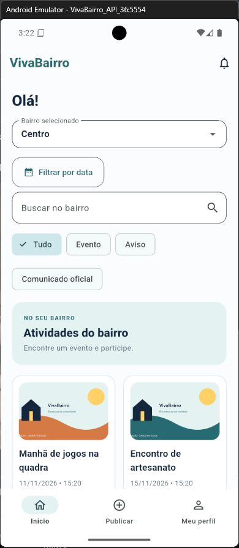
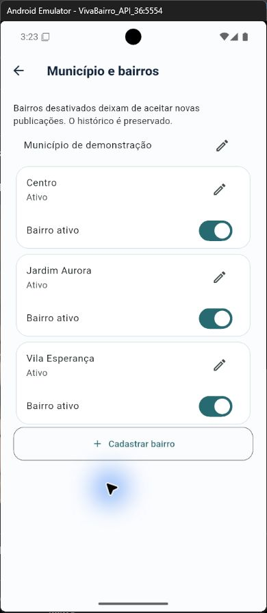

# Estado da implementação

O VivaBairro é um aplicativo Flutter para Android com API Fastify/TypeScript e PostgreSQL. A demonstração usa [Render](https://vivabairro-api.onrender.com) para a API e Neon para o banco. Esta página consolida o estado verificado em 08/11/2026; requisitos desejados e funções disponíveis não são a mesma coisa.

## Funcionalidades disponíveis

| Área | Comportamento |
| --- | --- |
| Conta | Cadastro, entrada, saída, perfil, alteração de senha, fluxos de recuperação/verificação e encerramento. Entrega externa de e-mail ainda indisponível. |
| Bairros | Bairro principal, acompanhamentos, feed de um bairro ou dos bairros acompanhados; sem GPS contínuo ou endereço residencial. |
| Feed | Eventos, avisos e comunicados; busca e filtros por tipo, categoria e período. |
| Eventos | Criar e editar conteúdo próprio, confirmar/cancelar presença e controlar capacidade com transação no banco. Sem fila de espera. |
| Avisos e colaboração | Criar, editar, responder, atualizar estado e remover publicações próprias. |
| Moderação | Denúncia, análise humana territorial, motivo, histórico, notificação e pedido de revisão por outro responsável. Denunciar não remove automaticamente. |
| Administração | Gestão de bairros, atribuições e comunicados no município autorizado. Cadastro comum não concede privilégios. |
| Imagens | Uma foto opcional por publicação, validada e armazenada no banco. |
| Notificações | Central interna e lembretes de eventos com preferências; sem push no sistema operacional. |

A [cobertura dos requisitos](../10-requisitos/requisitos-funcionais-nao-funcionais.md) detalha critérios e limites. A [arquitetura](../8-arquitetura-tecnica/visao-arquitetura.md) explica as responsabilidades.

## Conta e dados

Senhas usam hash scrypt com sal. Tokens aleatórios têm hash armazenado no servidor e sessões com prazo de sete dias. O aplicativo utiliza armazenamento seguro para credenciais. Recuperação e verificação usam códigos de uso único com validade de 30 minutos; recuperar a senha revoga sessões.

A caixa de e-mails local atende somente contas fictícias do seed, domínio @vivabairro.test, requisição loopback e DEMO_MODE ativo fora de produção. Não é uma caixa pública e não está habilitada online. Há preparação de fila SMTP com TLS, mas nenhum provedor externo conectado.

Encerrar a conta exige senha e confirmação. O processo remove sessões, preferências, imagens e conteúdo público, substitui identificação e textos pessoais e preserva referências técnicas mínimas. Não equivale a política jurídica de retenção nem apaga backups automaticamente. O último administrador municipal não pode encerrar a conta sem sucessão; ainda não existe interface para transferir essa responsabilidade.

Rascunhos ficam em preferências locais, separados por conta e publicação. Não são criptografados como credenciais. Não há leitura offline do feed nem envio automático de publicações pendentes.

## Imagens e lembretes

Fotos aceitam JPG, PNG ou WebP até 2 MB. O servidor valida conteúdo e resolução, remove metadados e converte para JPEG. Acesso exige sessão e permissão. As imagens ficam no PostgreSQL; limites de volume por conta e armazenamento de objetos precisam de decisão para escala. Uploads não publicados permanecem para retomada do rascunho; falta política de limpeza.

Lembretes internos cobrem eventos confirmados nas próximas 24 horas, respeitam preferência, presença ativa e cancelamento e evitam duplicação. Com JOBS_ENABLED ativo, o processamento ocorre a cada minuto enquanto a API está em execução; npm run jobs:run permite uma rodada manual. A suspensão do serviço gratuito pode atrasar esse processamento. Não há notificação externa com o aplicativo fechado.

## Interface e acessibilidade

O [SVG de referência](../9-prototipo-interface/prototipo-wireframes.md) orienta cores e hierarquia. A navegação usa Início, Publicar e Meu perfil. Material 3 apoia controles e estados; datas e mensagens usam português brasileiro. Formulários preservam texto em erro e oferecem confirmação, carregamento e recuperação. Grupos de ações mantêm intervalos de 12 pixels e espaço ao quebrar linha.

Diálogos rolam com teclado aberto, seletores acomodam texto ampliado e o conteúdo respeita a área segura inferior do Android. Cartões expõem ação e rótulo semântico, títulos são cabeçalhos e estados não dependem só de cor. A [página de testes](../rt03/usabilidade-e-testes.md) registra revisão visual, fonte ampliada e TalkBack, com capturas e limitações.

## Evidências técnicas

A API registra 16 testes aprovados no executor e Flutter registra 18 testes aprovados, além de análise estática sem problemas. Um roteiro nativo de criação, edição, resolução e remoção de aviso passa no emulador Android 16/API 36 com API local. Lint, formatação, compilação e testes constam na [execução de CI](https://github.com/carlosfrochaf/VivaBairro/actions/runs/42490292213) do commit 5fd363e. Esses resultados não são testes em aparelho físico nem certificação de acessibilidade.

A revisão inclui autoria, escopo territorial, proteção da última vaga, revisão por outro responsável, persistência entre instâncias, formatos de imagem, códigos, encerramento de conta e deduplicação de lembretes. O override de minimatch 11.0.5 na ferramenta de lint trata o advisory GHSA-g3hv-75wg-m249; deve permanecer somente enquanto necessário às dependências transitivas.

## Ambiente online e dados fictícios

A API está publicada no Render Free, em Virginia, conectada ao Neon PostgreSQL 18 em São Paulo. Migrações, saúde e operações de cadastro, sessão, gravação/leitura e autorização são verificadas por HTTPS. A conta do responsável possui papel administrativo municipal, com atribuição transacional e auditada. Isso não representa validação institucional de prefeitura.

O banco online contém oito autores fictícios, 12 eventos, dez avisos e 12 imagens, participações e respostas. Não há senhas públicas dessas contas nem outros papéis privilegiados criados pela carga. O script scripts/prepare-online-demo.mjs gera SQL para operação manual, sem conexão remota automática. A importação é idempotente, validada duas vezes em schema isolado; não sobrescreve publicações existentes.

O seed local é um conjunto separado: 14 eventos, 11 avisos e um comunicado, incluindo exemplos iniciais. A senha local vem de SEED_PASSWORD e não deve ser copiada para o ambiente online. npm run demo:refresh reagenda eventos cadastrados pelo seed para apresentações futuras, sem apagar publicações da interface.

APKs debug ARM64, ARM32 e x86_64 são gerados para apresentação; x86_64 está conferido no emulador. As variantes ARM não têm teste físico registrado. Configuração e comandos ficam em [hospedagem](IMPLANTACAO.md) e [demonstração](APRESENTACAO.md).

## Pendências para uso real

Faltam teste em aparelho físico, desempenho em release, orientação horizontal, avaliação com moradores e revisão completa com leitor de tela. A revisão TalkBack não avalia áudio, e fotos ainda possuem descrição genérica. E-mail externo, push e IA externa não estão conectados.

A equipe precisa definir validação de autoridade municipal, operação da moderação, retenção e descarte, limpeza de imagens, backup e restauração, observabilidade e resposta a incidentes. O limitador de requisições é local por processo; múltiplas instâncias exigem controle compartilhado. Assinatura de distribuição e teste de carga também não estão concluídos. Não há promessa medida de tamanho, memória ou taxa de quadros.

As [referências](../referencias-e-pesquisa.md) apoiam as escolhas técnicas e o [relatório de IA](../rt03/relatorio-ia.md) explica a autoria assistida. Não há registro de revisão humana integral do código.
