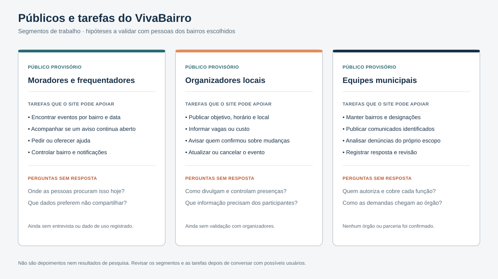
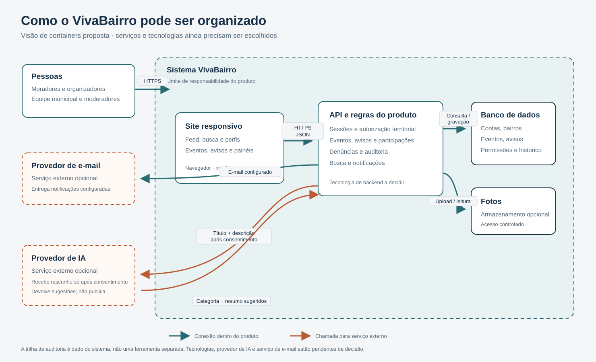
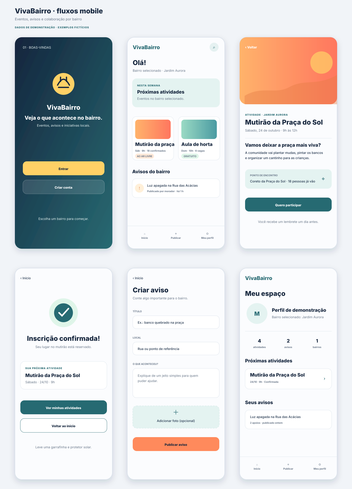

# RT03 — Consolidação do projeto

Esta seção reúne a entrega RT03 do VivaBairro: documentação consolidada, versão Alfa executável, relatório do uso de Inteligência Artificial (IA) e evidências de usabilidade. Registro: este GitBook e o repositório [carlosfrochaf/VivaBairro](https://github.com/carlosfrochaf/VivaBairro).

## Onde está cada item do template

| Item do template RT03 | Onde encontrar |
| --- | --- |
| 1. Documentação escrita consolidada (escopo, requisitos, arquitetura, protótipo) | Esta página, seção [Documentação consolidada](#documentacao-consolidada) |
| 2. Protótipo interativo / versão Alfa executável | Online em [vivabairro-alfa.onrender.com](https://vivabairro-alfa.onrender.com); guia em [Versão Alfa executável](versao-alfa.md) e código em `app/` |
| 3. Relatório do uso de IA no desenvolvimento | [Relatório de uso de IA](relatorio-ia.md) |
| 4. Evidências de usabilidade: validação de entradas, tratamento de erros e testes unitários | [Usabilidade, validação e testes](usabilidade-e-testes.md) |

## Documentação consolidada

### Escopo

O VivaBairro é um site responsivo que organiza eventos, avisos e pedidos de colaboração por município e bairro. A primeira versão planejada cobre feed por bairro, busca e filtros, eventos com confirmação de presença, avisos com estado, respostas a pedidos de ajuda, denúncia e moderação com histórico, administração municipal e sugestão opcional de IA com consentimento.

Ficam fora da primeira versão: canal de emergência, GPS contínuo, mensagens privadas, publicação ou moderação automática por IA e publicidade segmentada. Detalhes em [Escopo do produto](../1-visao-geral/documento-escopo.md).

Os três públicos (moradores, organizadores locais e equipes municipais) continuam como hipóteses: ainda não houve entrevista nem validação registrada. Ver [Públicos e tarefas](../1-visao-geral/publicos-e-tarefas.md).

### Requisitos

São 15 requisitos funcionais (RF-01 a RF-15) e 10 não funcionais (RNF-01 a RNF-10), cada um com critério observável. A tabela completa está em [Requisitos funcionais e não funcionais](../10-requisitos/requisitos-funcionais-nao-funcionais.md). A [Versão Alfa](versao-alfa.md#cobertura-dos-requisitos) indica quais já têm implementação e quais continuam pendentes.

### Arquitetura

A arquitetura separa site responsivo, API com regras do produto, banco de dados e serviços externos opcionais (e-mail, armazenamento de fotos e IA). O navegador não decide permissões: o servidor valida entrada, conta, papel e bairro. Ver [Arquitetura do VivaBairro](../8-arquitetura-tecnica/visao-arquitetura.md) e [Modelo conceitual de dados](../8-arquitetura-tecnica/modelo-dados.md).

A Alfa aplica essa separação em escala reduzida:

| Camada da arquitetura | Na Alfa |
| --- | --- |
| Site responsivo | `app/public/` (HTML, CSS e JavaScript sem framework) |
| API e regras do produto | `app/src/servidor/servidor.js` e `app/src/dominio/` |
| Banco de dados | `app/src/servidor/repositorio.js`, em memória, com dados fictícios |
| Serviço externo de IA | `app/src/integracoes/ia.js`, com provedor **simulado** |

As regras de validação (`app/src/dominio/validacao.js`) rodam no navegador, para dar retorno imediato, e de novo no servidor, onde valem de fato.

### Protótipo final

O protótipo tem seis telas: boas-vindas, início, detalhe do evento, confirmação, criar aviso e perfil. A Alfa implementa essas seis telas com dados vindos do backend, incluindo as telas de entrar e criar conta que a tela 01 abre. Os fluxos de consentimento da IA e de moderação municipal estão em [Telas e fluxos](../9-prototipo-interface/prototipo-wireframes.md).

## Estado do projeto na RT03

- **Existe e funciona:** versão Alfa, local e online, com criar conta, entrar e sair, feed por bairro, busca, detalhe e confirmação de evento, criação de aviso com validação e rascunho, sugestão de IA simulada com consentimento, perfil e mudança de estado de avisos. São 90 testes automatizados, todos passando.
- **Ainda é proposta:** recuperação de senha por e-mail, moderação, administração municipal, notificações, banco de dados persistente, integração com um provedor de IA real e implantação pública.
- **Sem evidência ainda:** nenhuma sessão de teste com moradores, organizadores ou equipe municipal foi registrada. As verificações de usabilidade desta entrega foram feitas pela equipe.

Para encerrar o desenvolvimento rumo à Beta, faltam: escolher a stack definitiva e o banco, completar a autenticação com recuperação de acesso (RF-01), moderação (RF-11 a RF-13) e o painel municipal (RF-14), e fazer sessões de uso com o roteiro da [matriz de rastreabilidade](../10-requisitos/rastreabilidade-usabilidade.md).
