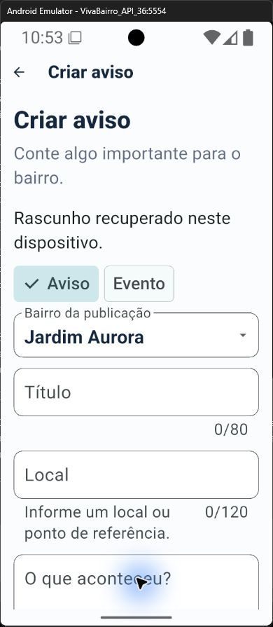
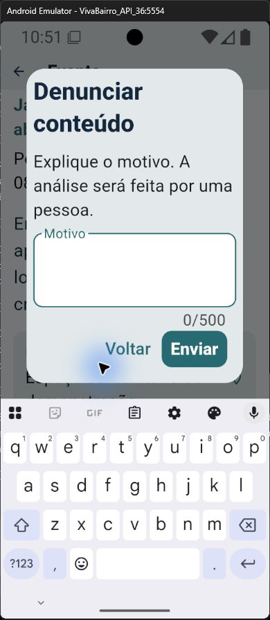
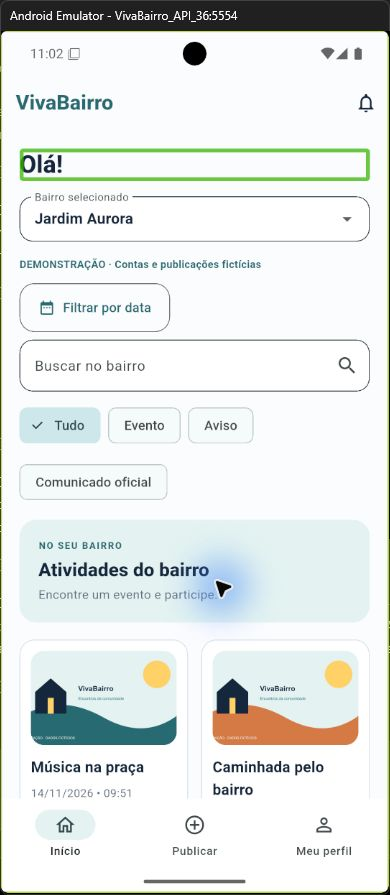

# Usabilidade, validação e testes

A revisão verifica se a pessoa identifica onde está, entende as ações e corrige erros sem perder o que escreve. As [heurísticas de Nielsen](https://www.nngroup.com/articles/ten-usability-heuristics/), o [Material Design 3](https://m3.material.io/) e a [acessibilidade Flutter](https://docs.flutter.dev/ui/accessibility) orientam a inspeção; não substituem avaliação com moradores.

## Aplicação nas telas

| Princípio | Aplicação |
| --- | --- |
| Visibilidade do estado | Bairro e filtros identificados, carregamento e confirmação das ações, estados escritos em texto. |
| Linguagem familiar | Participar, publicar, responder e resolver; mensagens explicam o que fazer. |
| Controle | Voltar, limpar filtros, cancelar presença e confirmar ações sensíveis. |
| Consistência | Identidade do SVG, componentes Material 3 e termos iguais para estados e papéis. |
| Prevenção | Validação de campos, revisão antes de publicar e checagem de autoria e território no servidor. |
| Reconhecimento | Seletores de bairros e categorias, rascunhos recuperáveis e ações contextualizadas. |
| Recuperação | Texto preservado em falhas, nova tentativa e orientação nos formulários. |
| Acessibilidade | Rótulos semânticos, cabeçalhos, cartões acionáveis, rolagem e estados que não dependem só de cor. |

A [rastreabilidade](../10-requisitos/rastreabilidade-usabilidade.md) relaciona necessidades, requisitos e interface. Controles mantêm espaço, acomodam quebras de linha e respeitam a área segura do Android.

## Verificações registradas em 08/11/2026

| Verificação | Resultado e alcance |
| --- | --- |
| API com PostgreSQL real | 16 testes no relatório do executor (15 subtestes e uma suíte), aprovados. Autorização, concorrência de vagas, moderação, imagens, recuperação, revogação, encerramento de conta e lembretes. |
| Flutter | 18 testes de widgets e cliente HTTP aprovados; análise estática sem problemas. Layouts estreitos, texto ampliado, rascunho e semântica. |
| Integração Android local | Um roteiro aprovado no emulador API 36: conta temporária, entrada, criação, edição, resolução e remoção de aviso; encerramento da conta ao final. |
| Integração contínua | Jobs API e Flutter aprovados no [GitHub Actions](https://github.com/carlosfrochaf/VivaBairro/actions/runs/42490292213), commit 5fd363e. O teste com emulador é local. |
| API online | Cadastro, sessão, gravação/leitura e recusa de comunicado oficial sem autorização verificados por HTTPS. Conta temporária encerrada. |
| App online | Feed com imagens e painel municipal conferidos no emulador; não cobre todo o fluxo remoto de moderação. |

As contagens descrevem as execuções registradas, não cobertura total. Esta revisão documental não executa novamente as baterias do aplicativo.

## Teclado e fonte ampliada

A inspeção nativa cobre feed, editor, categorias, perfil, preferências, segurança, detalhe de evento e diálogo de denúncia. Editor e diálogo são conferidos com teclado aberto e fonte ampliada. Testes reproduzem telas de 320/360 pixels, escala de texto 2x e teclado simulado de 300 pixels. Diálogos roláveis, seletores adaptáveis e margens dos botões tratam os transbordamentos identificados.

## TalkBack

A revisão parcial verifica foco sequencial no feed e detalhe, abertura de cartão por toque duplo, campo de motivo, fechamento do diálogo e retorno do foco. Cartões expõem papel de botão e rótulo contextual; títulos são cabeçalhos; notificações indicam lida ou não lida. A fonte está restaurada ao tamanho padrão.

Não há avaliação do áudio ou compreensão da fala. Cadastro, recuperação, administração, upload e todos os erros ainda não têm revisão completa com leitor. Testes de listas administrativas vazias não comprovam todos os estados. Descrição alternativa específica por foto permanece uma melhoria a planejar.

## Validação com pessoas

Não há sessões concluídas com moradores nem teste em aparelho físico. A equipe precisa observar tarefas como encontrar evento, cancelar presença, publicar aviso e solicitar revisão. O registro deve incluir contexto, tarefa, dificuldade, resultado e limitação, sem inventar participantes ou métricas. Orientação horizontal, desempenho em release e revisão completa de acessibilidade também estão pendentes.
